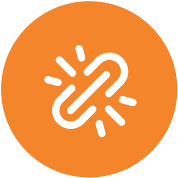
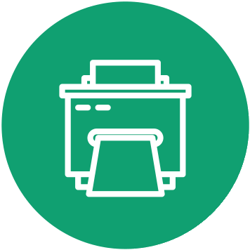
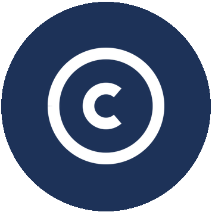
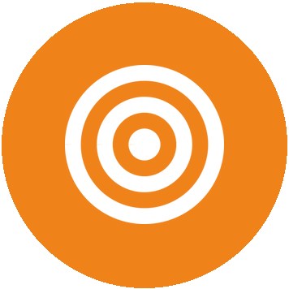

# Kit-com-V2 — logos, icônes et charte (conception)

Ce dossier **n’entre pas dans les paquets SCORM**. `build.sh` ne zippe que `modules/`.
Ce sont des **références et guides** pour la conception (charte, schémas, icônes, motion).

Source d’origine : `~/Desktop/KIT COM et LOGOS` (importées telles quelles dans `sources/`).

## Arborescence

- `sources/` — originaux (AI, PDF, PPTX, DOCX, PNG)
- `schemas/` — schémas fascicules exportés en PNG transparent
- `icones/` — ensemble 1 (cycle, schéma 5) ; `icones/incrustations/` — ensemble 2
- `bibliotheque/` — **bibliothèque unique PNG** (cycle + incrustations nouvelles + objets fascicules isolés + schémas). Voir `bibliotheque/README.md` et `bibliotheque/catalogue.json`
- `logos/` — signature Oser pour innover, QR, bandeau 32 partenaires
- `charte/` — médias extraits de la charte graphique vidéos (motion + images)
- `supports/` — kakemono générique en PNG
- `incrustation/` — **stills PNG Monica uniquement** (1920×1080, fond transparent, sans cadre) : texte, pictos et schémas 16:9. Voir `incrustation/README.md`. Régénération : `python3 scripts/export_incrustations_png.py`

Deux ensembles. **Préférer l’ensemble 1** dès que le concept existe dans le cycle. L’ensemble 2 complète uniquement les notions absentes du schéma 5 (PI, contrats, écosystème). Couleurs officielles (vidéo, print et SCORM) : prune `#63003C`, bleu `#1D3258`, orange `#F0821A`, vert `#00AE68`. Phases : **orange** = recherche et expérimentation ; **marine** = propulsion ; **vert** = utilité collective.

## Ensemble 1 — icônes du cycle de l’innovation

Pictogrammes isolés des schémas 2 à 5, **nommés comme sur le schéma 5**, PNG sans fond (extérieur transparent).

| Fichier | Concept | Visuel | Couleur |
|---|---|---|---|
| `icones/IDÉE.png` | **IDÉE** | Ampoule allumée | orange |
| `icones/CRÉATIVITÉ.png` | **CRÉATIVITÉ** | Tête / cerveau ouvert, crayon et arc-en-ciel | orange |
| `icones/SOLUTIONS.png` | **SOLUTIONS** | Ampoule avec coche | orange |
| `icones/SÉLECTION.png` | **SÉLECTION** | Documents superposés et curseur | orange |
| `icones/PROTOTYPAGE.png` | **PROTOTYPAGE** | Maillon / lien | orange |
| `icones/EXPÉRIMENTATION.png` | **EXPÉRIMENTATION** | Fiole (erlenmeyer) | orange |
| `icones/DÉCOUVERTE.png` | **DÉCOUVERTE** | Clé | marine |
| `icones/VALORISATION.png` | **VALORISATION** | Document et crayon | marine |
| `icones/TRANSFERT.png` | **TRANSFERT** | Avion en papier | marine |
| `icones/DESIGN.png` | **DESIGN** | Crayon et clé à molette | vert |
| `icones/PRODUCTION.png` | **PRODUCTION** | Imprimante | vert |
| `icones/DIFFUSION.png` | **DIFFUSION** | Mégaphone | vert |
| `icones/ADOPTION et IMPACT.png` | **ADOPTION et IMPACT** | Mains qui portent une ampoule | vert |

Aperçu :

## Ensemble 2 — pictogrammes d’incrustation

Même format (disque 356×356, trait blanc, couleurs de phase). Dossier `icones/incrustations/`. Catalogue : `icones/catalogue.json`.

| Fichier | Concept | Visuel | Couleur |
|---|---|---|---|
| `icones/incrustations/question.png` | **QUESTION** | Point d’interrogation | orange |
| `icones/incrustations/secret.png` | **SECRET** | Cadenas | marine |
| `icones/incrustations/protection.png` | **PROTECTION** | Bouclier | marine |
| `icones/incrustations/financement.png` | **FINANCEMENT** | Pièces | marine |
| `icones/incrustations/dialogue.png` | **DIALOGUE** | Bulles | orange |
| `icones/incrustations/etablissement.png` | **ÉTABLISSEMENT** | Immeuble | marine |
| `icones/incrustations/enveloppe.png` | **ENVELOPPE** | Enveloppe | marine |
| `icones/incrustations/logiciel.png` | **LOGICIEL** | Chevrons de code | marine |
| `icones/incrustations/marque.png` | **MARQUE** | ® | vert |
| `icones/incrustations/droit-auteur.png` | **DROIT D’AUTEUR** | © | marine |
| `icones/incrustations/actif.png` | **ACTIF** | Diamant | marine |
| `icones/incrustations/strategie.png` | **STRATÉGIE** | Courbe | marine |
| `icones/incrustations/alerte.png` | **ALERTE** | Triangle | orange |
| `icones/incrustations/partenaire.png` | **PARTENAIRE** | Poignée de main | vert |
| `icones/incrustations/equilibre.png` | **ÉQUILIBRE** | Balance | marine |
| `icones/incrustations/temps.png` | **TEMPS** | Horloge | orange |
| `icones/incrustations/cible.png` | **CIBLE** | Cible | orange |
| `icones/incrustations/pivot.png` | **PIVOT** | Flèches circulaires | orange |
| `icones/incrustations/contact.png` | **CONTACT** | Carnet | marine |
| `icones/incrustations/sans.png` | **SANS** | Cercle vide | marine |

Aperçu :

Régénération des PNG d’incrustation + copie runtime : `python3 scripts/generate_icones_incrust.py`

## Schémas (PNG)

| Fichier | Contenu |
|---|---|
| `schemas/f1-ecosysteme-innovation.png` | Écosystème de l’innovation (France / Europe / International) |
| `schemas/f2-cycle-3-phases.png` | Cycle de l’innovation — 3 phases (idée → adoption et impact) |
| `schemas/f2-cycle-phase-recherche.png` | Phase recherche et expérimentation |
| `schemas/f2-cycle-phase-propulsion.png` | Phase propulsion (expérimentation → transfert) |
| `schemas/f2-cycle-phase-utilite.png` | Phase utilité collective (transfert → adoption) |
| `schemas/f2-cycle-complet.png` | Le cycle de l’innovation (vue d’ensemble) |
| `schemas/f2-chaine-valorisation.png` | Chaîne de valorisation (recherche → innovation) |
| `schemas/f2-valorisation-shs.png` | Valorisation en SHS (cinq voies) |
| `schemas/f2-parcours-sensibilisation-esr.png` | Parcours de sensibilisation / acculturation des cadres de l’ESR |
| `schemas/f2-parcours-entrepreneuriat.png` | Parcours entrepreneuriat (détection → transfert) et écosystème |

## Charte graphique programme (modèle Paris-Saclay)

Document de référence A4, 12 pages, calé sur la charte Université Paris-Saclay :

`charte/Charte-graphique-Oser-pour-innover.pdf` (13 pages : page 6 = ensemble 1, page 13 = ensemble 2)

Régénération : `python3 scripts/build_charte_opi.py`

La charte UPS d’origine (modèle) est archivée dans `sources/Charte-graphique-UniversiteParisSaclay.pdf`.

## Charte graphique vidéos

Originaux : `sources/Charte graphique vidéos MOOC.pptx` et `sources/Modèle type Oser pour innover.pptx`.

Stills officiels (ce qui est monté dans les capsules) dans `charte/media/` :

- `ouverture-video.png` — carton blanc, logo neuronal 2D + titre vert + nom
- `transition-video.png` — bandes diagonales orange / marine / prune / vert
- `bandeau-intervenant.png` — nom + fonction, texte blanc sur fond noir

Pictos et schémas : **style fascicule** (disques du cycle, PNG extraits). Les pictos filaires et cartes du PPTX vidéo ne sont pas la référence.

Motion extrait dans `charte/motion/` :

- `logo-standard-anime-sonorise.mp4`
- `logo-expert-temoignage-anime-sonorise.mp4`
- `jingle-a.wav` / `jingle-b.wav`
- `bandeau-intervenant.mp4`
- `transition.mp4`
- `exemples-illustrations-animees.mp4`
- `texte-anime-1.mp4` … `texte-anime-4.mp4`

Le PPTX `icones et images cycle inno MH.pptx` contient le même cycle (formes natives PowerPoint, pas d’images liées).

## Logos et supports

- `logos/logo signature.png` — logotype OSER POUR INNOVER + visuel neuronal
- `logos/Oser pour innover QR.png`
- `logos/Capture logos 2026 32 partenaires.JPG` — fondateurs / partenaires / financeur
- `supports/kakemono-generique.png` — panneau BAT

Le ZIP `transfer_*.zip` du bureau n’a pas été recopié : il dupliquait déjà les AI/PDF des schémas.
